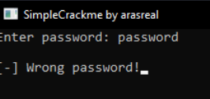
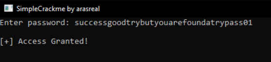
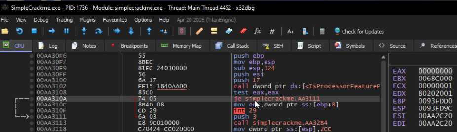
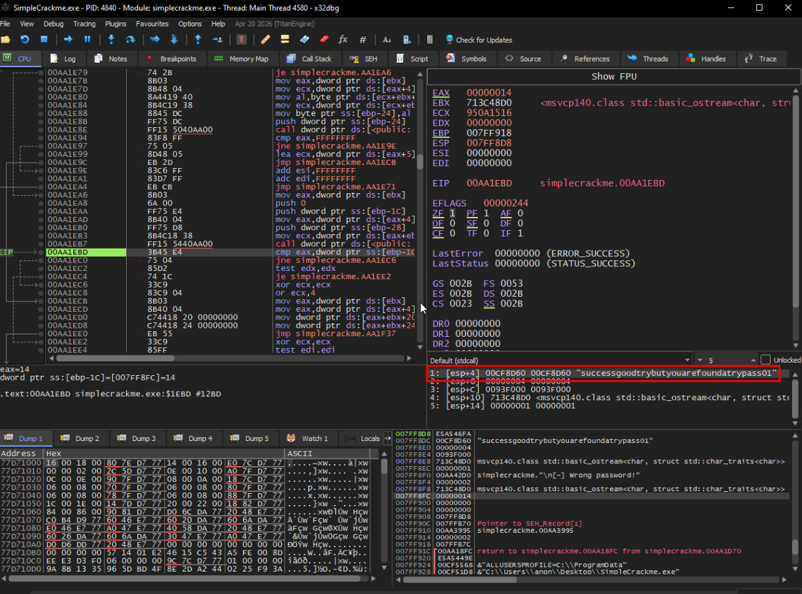

# SimpleCrackMe by arasreal
https://crackmes.one/crackme/69b33ffcddd6176826ae8975

## info
Language: C/C++

Platform: Windows

Arch: x86

Difficulty: 1.4

Labels: Anti-debugging, IsDebuggerPresent

## writeup
при запуске программа просит ввести пароль, по классике. Вводим и видим что он некорректен.


`strings` нашла несколько любопытных строк. Видимо, части пароля, 
а также функцию `IsDebuggerPresent` - противодействие отладке (как понятно и по тегам)
- succ
- good
- found
- pass

запускаем `radare2` и дизассемблируем функцию *main*. Сразу видно, что код при обнаружении отладчика падает (что позже исправим). 
Также видно строки, которые мы нашли ранее. Видимо, они склеиваются некой функцией.
```assembly
0x0040125d      ff1508404000   call dword [sym.imp.KERNEL32.dll_IsDebuggerPresent] ; 0x404008
0x00401263      85c0           test eax, eax
0x00401265      7430           je 0x401297
0x00401267      681c424000     push str.DEBUGGER_DETECTED_ ; 0x40421c ; "DEBUGGER DETECTED!"
...
0x004012f4      6878424000     push str.succ               ; 0x404278 ; "succ" ; int32_t arg_8h
0x004012f9      8d8da0feffff   lea ecx, [var_160h]
0x004012ff      e8cc100000     call fcn.004023d0
0x00401304      6880424000     push 0x404280               ; "ess" ; int32_t arg_8h
0x00401309      8d8db8feffff   lea ecx, [var_148h]
0x0040130f      c645fc01       mov byte [var_4h], 1
0x00401313      e8b8100000     call fcn.004023d0
0x00401318      6884424000     push str.good               ; 0x404284 ; "good" ; int32_t arg_8h
0x0040131d      8d8dd0feffff   lea ecx, [var_130h]
0x00401323      c645fc02       mov byte [var_4h], 2
0x00401327      e8a4100000     call fcn.004023d0
0x0040132c      688c424000     push 0x40428c               ; "try" ; int32_t arg_8h
0x00401331      8d8de8feffff   lea ecx, [var_118h]
0x00401337      c645fc03       mov byte [var_4h], 3
0x0040133b      e890100000     call fcn.004023d0
0x00401340      6890424000     push 0x404290               ; "but" ; int32_t arg_8h
0x00401345      8d8d00ffffff   lea ecx, [var_100h]
0x0040134b      c645fc04       mov byte [var_4h], 4
0x0040134f      e87c100000     call fcn.004023d0
0x00401354      6894424000     push 0x404294               ; "you" ; int32_t arg_8h
0x00401359      8d8d18ffffff   lea ecx, [var_e8h]
0x0040135f      c645fc05       mov byte [var_4h], 5
0x00401363      e868100000     call fcn.004023d0
0x00401368      6898424000     push 0x404298               ; "are" ; int32_t arg_8h
0x0040136d      8d8d30ffffff   lea ecx, [var_d0h]
0x00401373      c645fc06       mov byte [var_4h], 6
0x00401377      e854100000     call fcn.004023d0
0x0040137c      689c424000     push str.found              ; 0x40429c ; "found" ; int32_t arg_8h
0x00401381      8d8d48ffffff   lea ecx, [var_b8h]
0x00401387      c645fc07       mov byte [var_4h], 7
0x0040138b      e840100000     call fcn.004023d0
0x00401390      68a4424000     push 0x4042a4               ; "at" ; int32_t arg_8h
0x00401395      8d8d60ffffff   lea ecx, [var_a0h]
0x0040139b      c645fc08       mov byte [var_4h], 8
0x0040139f      e82c100000     call fcn.004023d0
0x004013a4      68a8424000     push 0x4042a8               ; "ry" ; int32_t arg_8h
0x004013a9      8d8d78ffffff   lea ecx, [var_88h]
0x004013af      c645fc09       mov byte [var_4h], 9
0x004013b3      e818100000     call fcn.004023d0
0x004013b8      68ac424000     push str.pass               ; 0x4042ac ; "pass" ; int32_t arg_8h
0x004013bd      8d4d90         lea ecx, [var_70h]
0x004013c0      c645fc0a       mov byte [var_4h], 0xa
0x004013c4      e807100000     call fcn.004023d0
0x004013c9      68b4424000     push 0x4042b4               ; "01" ; int32_t arg_8h
0x004013ce      8d4da8         lea ecx, [var_58h]
0x004013d1      c645fc0b       mov byte [var_4h], 0xb      ; 11
```

судя по всему, пароль - `successgoodtrybutyouarefoundatrypass01`.

проверяем и видим, что он проходит.


---

однако я выбрал этот crackme именно из за методов антиотладки.

есть два пути:
1) патчить бинарник, чтобы пропускать эту проверку.
2) поменять возвращаемое значение на лету.

попробуем пройти по второму пути, а потом по первому.

запускаем `x32dbg` и ищем похожий код, что мы видели в `radare2`.


попробуем поменять значение EAX прямо так. Ошибка, программа переходит к коду, который вызывает `int 29`.
Попробуем поменять ZF. Проходим.

вторая проверка, снова через `IsDebuggerPresent`. Ещё раз подменяем значение EAX и проходим дальше.


доходим до проверки пароля и видим в стеке его полностью.


---

теперь попробуем пропатчить бинарник (перезапустить с флагом `-w` или ввести команду `oo+` для запуска с правом на запись). 
Для этого вытащим адреса с проверками:
- 0x00401265	je 0x401297
- 0x004031f9	jne 0x403208

выставим адрес, убедимся что мы в нужном месте.
```assembly
[0x00402c20]> s 0x00401265
[0x00401265]> pd 5
│       ┌─< 0x00401265      7430           je 0x401297
│       │   0x00401267      681c424000     push str.DEBUGGER_DETECTED_ ; 0x40421c ; "DEBUGGER DETECTED!"
│       │   0x0040126c      ff1500404000   call dword [sym.imp.KERNEL32.dll_SetConsoleTitleA] ; 0x404000 ; "|O"
│       │   0x00401272      8b0d74404000   mov ecx, dword [sym.imp.MSVCP140.dll_class_std::basic_ostream_char__struct_std::char_traits_char___std::cout] ; [0x404074:4]=0x4fee reloc.MSVCP140.dll__cout_std__3V__basic_ostream_DU__char_traits_D_std___1_A
│       │   0x00401278      ba30424000     mov edx, str.____Debugger_Detected_ ; 0x404230 ; "[-] Debugger Detected!"
```

теперь выполняем команду `wa jmp 0x401297` и проверяем, всё ли записалось.
```assembly
[0x00401265]> wa jmp 0x401297
Written 2 byte(s) (jmp 0x401297) = wx eb30
[0x00401265]> pd 2
│       ┌─< 0x00401265      eb30           jmp 0x401297
│       │   0x00401267      681c424000     push str.DEBUGGER_DETECTED_ ; 0x40421c ; "DEBUGGER DETECTED!"
```

точно также и со вторым адресом.

и теперь видим, что отладчик проходит все проверки - программа спокойно продолжает выполнение, не смотря на его присутствие.

прикладываю также патчер для этого крякми.