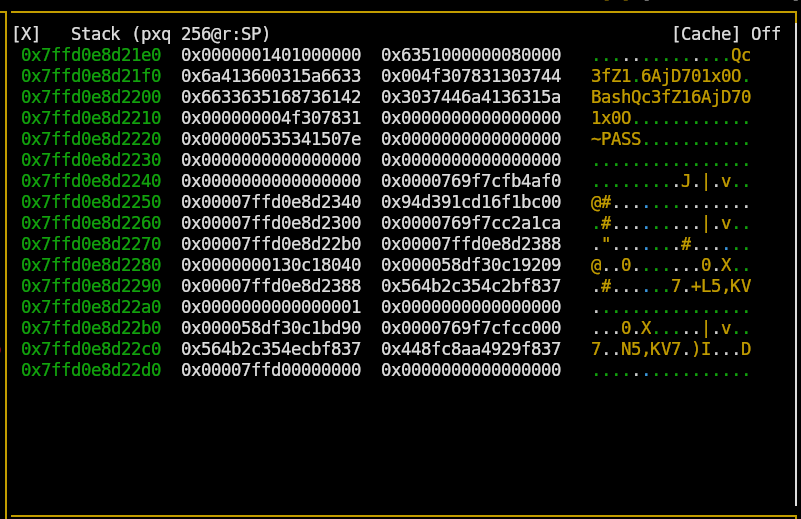

# Wheredakey by Glitch_Baby
https://crackmes.one/crackme/6ab4ce5195b976f8f1300b54

## info
Language: C/C++

Platform: Unix/linux etc.

Arch: x86-64 

Difficulty: 1.2

## writeup
при запуске программа сообщает, кто автор и просит ввести пароль. Закономерно получаем ошибку.
```bash
This crackme is brought to you by GlitchBaby


Enter the Password: password

 Nuh uh, Study more bruh
```

`strings` нашла несколько любопытных строк. Видимо, части пароля.
- BashH
- Qc3f
- 6AjD701xH

запускаем `radare2` и дизассемблируем функцию *main*. Анализатор сразу отобразил переменные и какие значения в них записываются. 
Похоже на те самые строки, которые нашёл `strings`.
```assembly
; var int64_t var_7ch @ rbp-0x7c
; var uint32_t var_78h @ rbp-0x78
; var char *s2 @ rbp-0x72
; var int64_t var_6fh @ rbp-0x6f
; var char *var_6bh @ rbp-0x6b
; var int64_t var_64h @ rbp-0x64
; var char *s1 @ rbp-0x60
; var int64_t var_58h @ rbp-0x58
; var int64_t var_57h @ rbp-0x57
; var int64_t var_4fh @ rbp-0x4f
; var char *var_40h @ rbp-0x40
; var int64_t var_8h @ rbp-0x8

0x00001224      c74584140000.  mov dword [var_7ch], 0x14
0x0000122b      48c745a04261.  mov qword [s1], 0x68736142  ; 'Bash'
0x00001233      48c745a80000.  mov qword [var_58h], 0
0x0000123b      48c745a90000.  mov qword [var_57h], 0
0x00001243      48c745b10000.  mov qword [var_4fh], 0
0x0000124b      c7458e516333.  mov dword [s2], 0x66336351  ; 'Qc3f'
0x00001252      c74591665a31.  mov dword [var_6fh], 0x315a66 ; 'fZ1'
0x00001259      48b836416a44.  movabs rax, 0x78313037446a4136 ; '6AjD701x'
0x00001263      48894595       mov qword [var_6bh], rax
0x00001267      c7459c78304f.  mov dword [var_64h], 0x4f3078 ; 'x0O'
```

далее идёт вывод сообщений, получение ввода, некоторые манипуляции со строками и сравнение. 
Судя по всему, пароль собирается в рантайме из тех строк, что нашёл анализатор.

```assembly
0x00001298      488d05ad0d00.  lea rax, [0x0000204c]       ; "%s"
0x0000129f      4889c7         mov rdi, rax                ; const char *format
0x000012a2      b800000000     mov eax, 0
0x000012a7      e844feffff     call sym.imp.__isoc99_scanf ; int scanf(const char *format)
0x000012ac      488d558e       lea rdx, [s2]
0x000012b0      488d45a0       lea rax, [s1]
0x000012b4      4889d6         mov rsi, rdx                ; const char *s2
0x000012b7      4889c7         mov rdi, rax                ; char *s1
0x000012ba      e841feffff     call sym.imp.strcat         ; char *strcat(char *s1, const char *s2)
0x000012bf      488d5595       lea rdx, [var_6bh]
0x000012c3      488d45a0       lea rax, [s1]
0x000012c7      4889d6         mov rsi, rdx                ; const char *s2
0x000012ca      4889c7         mov rdi, rax                ; char *s1
0x000012cd      e82efeffff     call sym.imp.strcat         ; char *strcat(char *s1, const char *s2)
0x000012d2      4889c2         mov rdx, rax
0x000012d5      488d45c0       lea rax, [var_40h]
0x000012d9      4889d6         mov rsi, rdx                ; const char *s2
0x000012dc      4889c7         mov rdi, rax                ; const char *s1
0x000012df      e8fcfdffff     call sym.imp.strcmp         ; int strcmp(const char *s1, const char *s2)
```

строки:
- Bash
- Qc3f
- fZ1
- 6AjD701x
- x0O

можно заметить, что у всех, кроме первого, повторяются последний-первое значение.

следовательно пароль - `BashQc3fZ16AjD701x0O`

	UPDATE: 
	интереса ради запустил radare2 в визуальном режиме, и программу. В стеке наглядно видно, что пароль такой.


проверяем пароль и видим сообщение об успехе (спасибо radare2 за то что очень помог).
```bash
This crackme is brought to you by GlitchBaby


Enter the Password: BashQc3fZ16AjD701x0O
Nice bruh you got it
```
